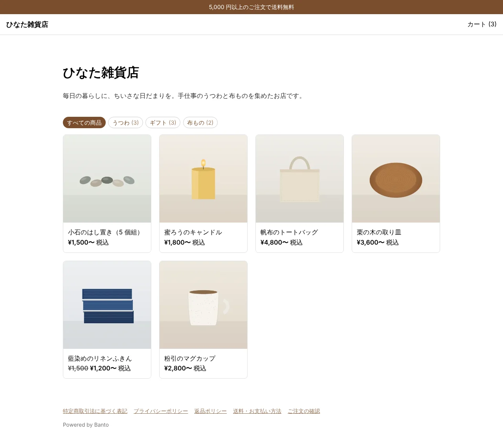
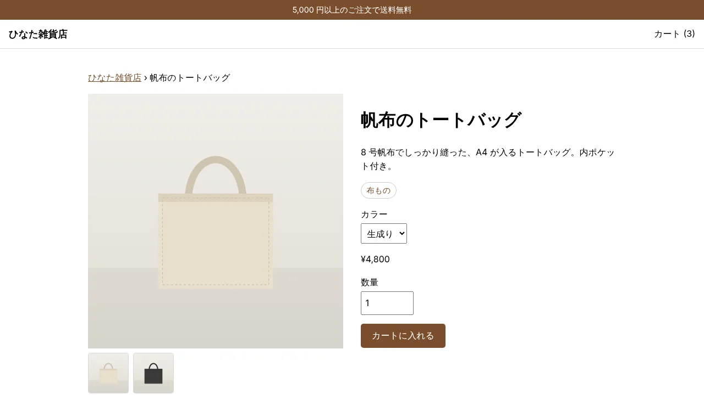
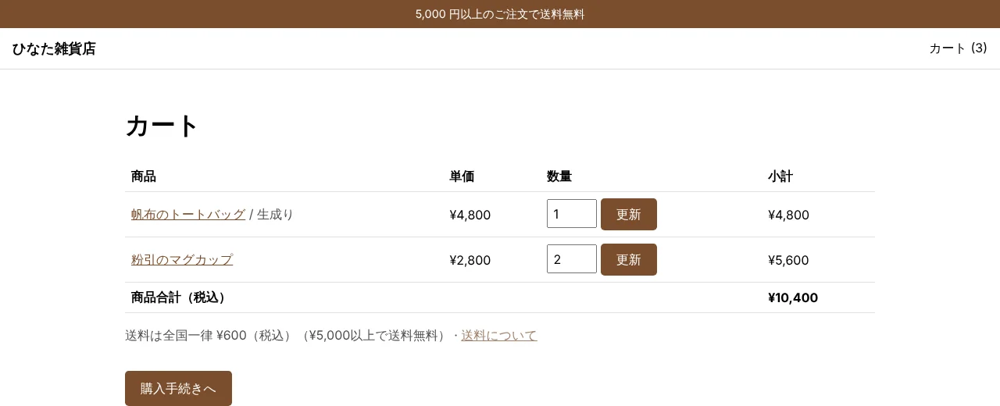
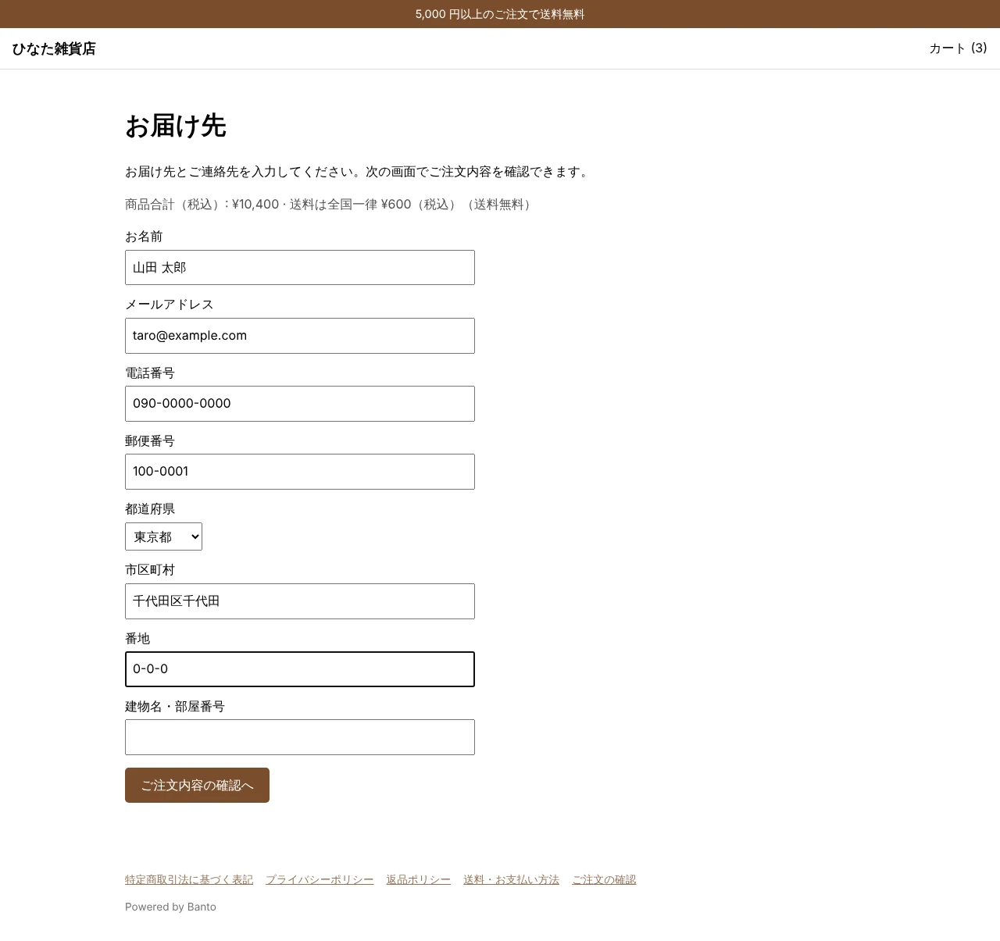
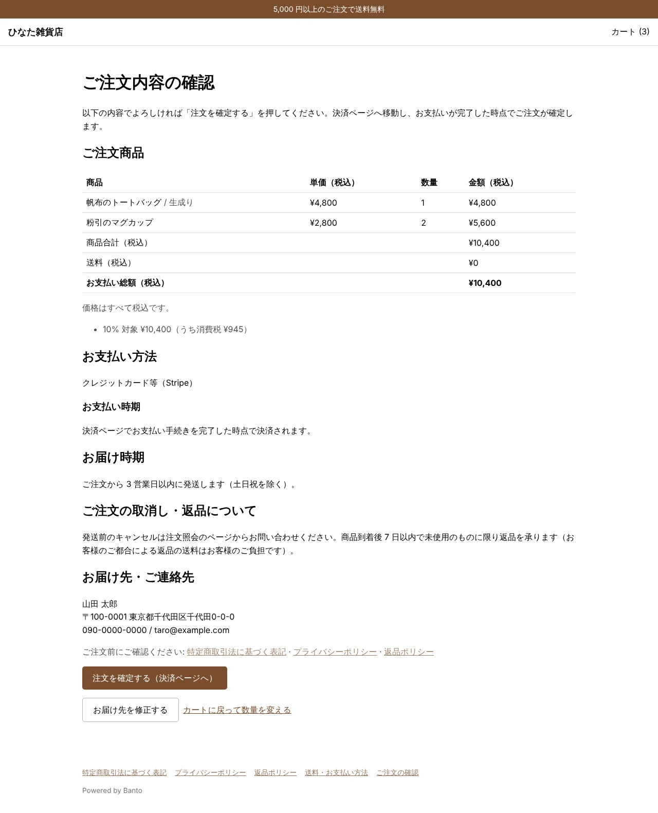
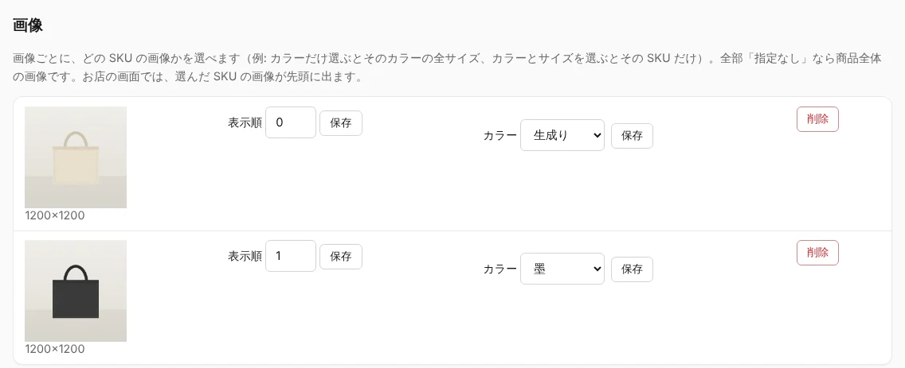

# お店の画面の使い方と GA4

管理画面 → ショップ設定 →「お店の画面の使い方」（0041 が必要）。

## URL（メンテナの決定 2026-11-05）

| 画面 | URL |
| --- | --- |
| お店のトップ | `/`（トップのひな形があればそのページ、無ければすべての商品の 1 ページ目） |
| すべての商品 | `/products` |
| 商品の詳細 | `/products/<商品>`（SKU を選んだ状態は `?sku=<品番>`） |
| カテゴリーの一覧 | `/categories/<カテゴリー>`（子のカテゴリーの商品も含む） |
| タグで絞る・探す・ページ送り | どの一覧にも `?tag=<タグ>`・`?q=<語>`・`?after=<位置>`（例: `/categories/tops?tag=秋&q=ニット`）。`?q=` は空白で区切った語をすべて含む商品（5 語まで。3 文字以上の語が 1 つも無ければ、カテゴリーかタグで絞っているときだけ探す） |
| 絞り込み（0150、メンテナの決定 2026-11-17） | `?tag=` をくり返すと **すべてのタグを持つ商品**（5 つまで。例: `?tag=秋&tag=セール`）。価格は `?filter.v.price.gte=<円>`（以上）・`?filter.v.price.lte=<円>`（以下）。名前は Shopify のテーマの絞り込みと同じ。価格は一覧の価格（いちばん安い SKU の価格、税込）で比べ、価格の無い商品は出しません。SKU の選択肢は `?filter.v.option.<鍵>=<値>`（0153。鍵は英字の鍵（`color`・`size` など）、くり返すと同じ鍵はどれか・鍵どうしはすべて。**在庫のある SKU の選択肢だけ** で、鍵ごとに見ます）。ブランドは `?filter.p.vendor=<ブランド>`（Shopify と同じ名前。1 つだけで、ちょうど同じ名前の商品。くり返したら最初の値。札の件数は 0162 から、メンテナの決定 2026-11-21）。ブランドで絞っていれば、2 文字以下の検索の語も探します |
| 並べ替え | どの一覧にも `?sort=`（`price_asc` 安い順・`price_desc` 高い順・`name` 名前順・`updated` 更新の新しい順。無ければ新しい順 = 商品の発売日（0146、管理画面の商品の編集・AI 用 API の `released_at`）の新しい順、発売日の無い商品は作った日で並べる）。Shopify のテーマの `?sort_by=`（`price-ascending`・`price-descending`・`title-ascending`・`created-descending`）も読みます（メンテナの決定 2026-11-06） |

- 独自ドメインの無いショップは、この前に `/<ショップ>` が付きます。
- 検索の結果（`?q=`）・2 ページ目以降・タグ 2 つ以上か価格か選択肢かブランドで絞った一覧は検索エンジンに載せません（組み合わせの数だけ同じような一覧を作らない）。並べ替えた一覧の canonical は並べ方を外した URL です（同じ一覧を別のページにしない）。サイトマップには `/products`・カテゴリーの一覧・商品が載ります。
- URL は `src/storefront/urls.ts` の 1 か所で組みます（テーマ・本文のブロック・パンくず・サイトマップ・商品フィード・構造化データが同じものを使う）。
- 2026-11-05 より前の URL（`/p/<商品>`・`/search`・`/?category=`・`/?all=1`）は使いません（転送もしません）。
- 同梱のテーマは、タグの札（押すとそのタグだけ、選んでいる札を押すと外す）・選択肢の札（鍵ごとに表示名と件数。押すと足す、選んでいる札を押すと外す、0153）・価格の欄（GET のフォーム）を一覧の上に出します。価格の欄の上限の目安は、公開の一覧のいちばん高い一覧の価格です。0150 を当てるまでのあいだは、最初のタグだけで絞り、価格の欄は出しません。

## 発売日と公開日（メンテナの決定 2026-11-17）

商品には日付が 3 つあります。

| 日付 | 決めるところ | 意味 |
| --- | --- | --- |
| 作成日 | （自動） | Banto に商品を作った日。書き換えません |
| **発売日** | 商品の編集の「発売日」・AI 用 API の `released_at` | この日から買えます。**未来の日付なら、お店には見えますが買えません（Coming Soon）**。新着順と、テーマの「新しい商品」の印もこの日（無ければ作成日） |
| **公開日** | 商品の編集の「公開日」・AI 用 API の `publish_at` | 非公開の商品を、この日時に公開します（Cron で公開するので数分の遅れがあります） |

- 両方を使うと「12月1日に公開して予告し、12月10日に発売」ができます（公開日 12/1、発売日 12/10、公開の印は外しておく）。
- 発売前の商品は、カートに入れられません（お店の画面は「発売予定です」、Shopify の `add.js` は 422、ヘッドレスのカートは 403 `coming_soon`）。お店で試着の申し込みもできません。発売日の時刻を過ぎれば、そのまま買えるようになります。
- 判定はカートの値付けと、データベースの在庫の予約の両方で行います（画面で隠すだけではありません）。
- 商品フィードでは在庫があっても `out_of_stock`、ページの構造化データは `OutOfStock` と `availabilityStarts`（発売日）です。
- テーマ（Liquid）は `product.coming_soon` と `product.released_at` で「11月20日 発売」を出せます（文言はテーマが持ちます）。既定のテーマは「{日付} 発売予定です」を出します。
- データベースの変更 `0146_product_released_at`（発売日）と `0148_product_sale_dates`（発売前は買えない・公開日）が要ります。

## 店頭のみの商品（メンテナの決定 2026-11-17）

1 点ごとに色味が違う・店頭の在庫だけ、のような「お店で試着して、買うかはお店で決める」商品に、商品の編集で **「店頭のみ（ネットでは購入できない）」** の印を付けます（AI 用 API は `store_only`）。データベースの変更 `0149_product_store_only` が要ります。

| | お店で試着（同梱モジュール）が ON | OFF |
| --- | --- | --- |
| お店の画面 | 見える。「ネットではご購入いただけませんが、カートに入れてお店で試着を申し込めます」 | 見える。「店頭でのお取り扱いのみです」 |
| カート | 入る（「店頭のみ」の印。**小計に入れない**） | 入らない（`add.js` は 422、ヘッドレスは 403 `store_only`） |
| お店で試着の申し込み | できる | — |
| 購入手続き（決済） | 進めない | 進めない |

- カートにほかの商品と一緒にあるときは、**購入手続きから外して**、最終確認の画面で「店頭でのお取り扱いのみの商品（…）は、ご購入の手続きに含めていません」と知らせます。店頭のみの商品だけのカートは、購入手続きに進めず、カートに戻して知らせます。
- 外した商品はカートに残ります（注文のあとも消しません）。そのまま「お店で試着」を申し込めます。「今すぐ買う」（本文の `::: product show=buy` など）でも、店頭のみの商品はカートに入れるだけです。
- 商品フィード（Google・Meta）には載せません。ページの構造化データは `InStoreOnly` です。
- 判定はカートの値付けと、データベースの在庫の予約の両方で行います。最終確認のあとで店頭のみにした商品は、確定の前に外して確認画面を出し直します。
- テーマ（Liquid）: 商品は `product.store_only`（`available` はカートに入れられるかで、お店で試着が ON なら true）、カートの行は `item.store_only`、`cart.has_store_only_items`。`cart.total_price` などの金額には店頭のみの行を入れません。
- 発売前（Coming Soon）・会員限定と重なったときは、カートにも入れられない理由が先です（発売前 → 会員限定 → 店頭のみ）。

## 検索用のキーワード（メンテナの決定 2026-11-21）

- 商品の編集の「検索用のキーワード」（200 文字まで）に入れた言葉でも、お店の検索（`?q=`）と公開 API の `q` に当たります。別の呼び方・型番・説明の先頭 300 文字に入らない特徴など、説明を長くせずに探せるようにするためのものです（0163）。
- **お客様の画面・公開 API・テーマには出しません**（商品の詳細の関数も返しません）。AI 用 API（`search_keywords`）と管理画面だけが読み書きします。
- 続く空白（全角を含む）は 1 つの半角の空白にそろえ、空なら外します。言葉の区切りは検索と同じ空白です。

## 1. お店の画面の使い方

WordPress・Instagram・自分で作ったサイトで商品を紹介し、Banto は在庫・注文・決済だけに使う、という使い方ができます。

| 使い方 | 商品の一覧・詳細 | カート〜最終確認 | 向いている連携（docs/headless.md） |
| --- | --- | --- | --- |
| **すべて Banto の画面を使う**（既定） | Banto | Banto | Banto だけでお店を開く |
| **カートと購入だけ Banto の画面を使う** | 外のサイト | Banto | A. 購入リンク（`/<ショップ>/buy`）・B. カート API。Instagram の投稿やプロフィールから購入リンクへ |
| **Banto の画面を使わない** | 外のサイト | 外のサイト | C. チェックアウト API |

- 使わない画面を開かれたら、**外のサイトの URL** へ転送します（302。設定を戻せばすぐ元に戻ります）。商品ページは **商品ページの URL**（`https://example.com/product/{slug}/` の `{slug}` を Banto の商品のスラッグに置き換え）へ転送するので、古いリンク・検索結果・SNS のリンクも外のサイトの商品ページに届きます。転送先を入れていなければ「ページが見つかりません」を出します。
- 使わない画面への POST（カートに入れる等）は 404 です。
- **どの使い方でも残す画面**: 法務（特商法の表記・プライバシーポリシー・返品）・送料の案内・注文照会と領収書・決済後の完了画面・会員のログインのリンクとコード入力・パスキーでのログイン（同梱モジュール passkey。ヘッドレスのログインもショップのドメインのこの画面を通るため）・商品フィード・お問い合わせ（同梱モジュール inquiries）。メールのリンク、決済事業者の戻り先、最終確認画面からのリンクがこれらを指すためです。
- 「使わない」では、会員ページ（パスキーの追加・一覧を含む）とクーポンの獲得ページ（`/coupons/<id>`）も外のサイトへ転送されます。クーポンは公開のコードか会員への発行で配ってください（登録画面にも出ます）。
- ヘッドレス API（`/api/shops/...`）・AI 用 API（`/api/v1`・`/mcp`）・Webhook はどの使い方でも動きます。
- サイトマップ: カートと購入だけ使うショップは法務のページだけ、使わないショップは載せません。
- 商品フィード（同梱モジュール「商品フィード」）の商品のリンクは、商品ページの URL を入れていればそちらになります（Instagram・Google のショッピングで、外のサイトの商品ページに案内するため）。
- 「Banto の画面を使わない」ときの会員のログイン: メールのリンクの行き先は `return_to` で外のサイトにしてください（docs/headless.md「会員」）。省くと Banto のログインの確認画面へのリンクになります（この画面は残しますが、ログインした後のアカウントの画面は外のサイトへ転送されます）。

### お客様が見る画面（すべて Banto の画面を使うとき）

商品の一覧 → 商品ページ → カート → お届け先 → **最終確認画面** → 決済ページ（Stripe・KOMOJU）の順に進みます。最終確認画面は特定商取引法の表示（分量・価格・支払いの時期と方法・引渡時期・申込みの撤回や解除の条件）を出す画面で、ここに出す文言はショップ設定の「上級者向け」→「購入前の確認画面」で入れます。

> 画面の画像は、架空の「ひなた雑貨店」で撮った見本です（既定のテーマ、アクセントカラーは茶）。

## 2. アクセス解析（同梱モジュールの `<head>` の口）

Banto の本体は、分析サービスの仕様を持ちません（CLAUDE.md §2）。代わりに、同梱モジュールがお店の画面の `<head>` にタグを入れられる口があります。

- 本体は、お店の画面で起きた出来事を中立の形で積みます（`src/storefront/events.ts`）。

  | 出来事 | いつ |
  | --- | --- |
  | `product_view` | 商品ページを開いた（SKU ごとの品番・名前・価格） |
  | `cart_add` | カートに入れた直後の商品ページ（入れた SKU と数量） |
  | `cart_view` | カートを開いた（中身と合計） |
  | `checkout_start` | 最終確認画面を開いた（明細と支払う額） |
  | `purchase` | 決済後の完了画面で、注文の確定が確かめられた（注文番号と支払った額） |

  氏名・メールアドレス・住所などの個人情報は入れません。
- ON の同梱モジュールが返す決まった形のタグ（https の外部スクリプトと、モジュールのコードが作るインラインのスクリプト）だけを `</head>` の前に入れます（`src/storefront/head.ts`）。運営者が入力した HTML をそのまま出す口はありません。
- 管理画面には入れません。テーマを差し替えても効きます。
- 今ある同梱モジュール: **Google アナリティクス（GA4）**（docs/ga4.md）。

## 3. SKU ごとの画像（カラー・サイズで画像を切り替える）

商品の画像を、カラーやサイズなどの選択肢に結べます（0063）。

- 管理画面の商品の「画像」の欄で、画像ごとに選択肢を選んで保存します（SKU に選択肢がある商品だけ欄が出ます）。
  - すべて「指定なし」… 商品全体の画像
  - カラーだけ（例: レッド）… レッドの SKU すべて（サイズは問わない）
  - カラーとサイズ（例: レッド・M）… その SKU だけ

  

- お店の商品ページで SKU を選ぶと、その SKU に結んだ画像が先頭に並び、大きな画像も切り替わります（細かく結んだ画像が先、次に商品全体の画像、ほかのカラーの画像は後ろ）。
- `?sku=<品番>` を付けた URL は、最初からその SKU の画像で開きます（スクリプトが動かない環境でも同じ）。商品フィードの商品ページの URL にもこれが付きます（docs/product-feed.md）。
- AI 用 API からは、登録のときに `options` を付けて結ぶか（`POST /api/v1/products/{id}/images`・`/images/upload`、MCP の `product_image_add`）、登録したあとに `PATCH /api/v1/images/{id}`（MCP の `product_image_set_options`）で結べます（docs/api.md）。ヘッドレスの公開 API は `image_variants[].options` を返します（docs/headless.md）。
- WooCommerce から取り込むと、バリエーションの画像はそのバリエーションの属性に結ばれます（docs/woo-import.md）。

## 4. SKU を分ける軸（カラー × サイズ・型番 × 長さ）

商品の SKU を、どの項目の組み合わせで分けるかを決められます（0065）。

- **決める場所**: 管理画面 → 商品 → カテゴリーの画面で、**ショップの既定** と **カテゴリーごとの軸**（親から子へ引き継ぐ）を決めます。例外の商品は、商品の画面で上書きします。
  - 例: 「ウェア」= カラー × サイズ、「ケーブル」= 型番 × 長さ、「雑貨」= 品番だけ。
  - 値の候補（サイズ: S、M、L…）も置けます。SKU の入力欄の候補と、組み合わせの一括作成に使います。候補に無い値も入れられます。
  - 値はチップで入れます（打って Enter で足す・× で消す・表計算ソフトから貼り付けると行ごとに分かれる）。区切りの文字を使わないので、`1,000mm` や `赤、白のボーダー` のようにカンマ・読点を含む値もそのまま入ります（スクリプトが動かないときは 1 行に 1 つ）。
- **写すとき**: 商品を作ったとき・主カテゴリーを決めたとき（SKU がまだ無いとき）に、上の段の軸を商品に写します。あとでカテゴリーの軸を変えても、すでにある商品は変わりません。変えたら「このカテゴリーの商品に当てる」を押すと、今の SKU がそのまま合う商品だけに当てます（合わない商品は名前を出します）。
- **軸を決めた商品の SKU**: 選択肢の欄が軸ごとになり、同じ組み合わせの SKU は作れません。「組み合わせをまとめて作る」で、値を選ぶだけで SKU をまとめて作れます（品番はひな形 `TEE-{カラー}-{サイズ}` から）。
- **お店の画面**: 商品ページの選択欄が軸ごと（カラー → サイズ）になり、在庫の無い組み合わせは選べません。スクリプトが動かない環境では、今までどおり 1 つの選択欄です。SKU ごとの画像（§3）も、選んだカラーで切り替わります。
- 決めていない商品（既存の商品・取り込んだ商品）も、SKU の選択肢の項目がそろっていれば、お店の画面は同じように軸ごとの選択欄になります。

## カテゴリーの画像と説明（0113）

管理画面 → 商品 → カテゴリーの各行の「画像と説明」で、カテゴリーに説明（文字だけ、2,000 字まで）と画像を付けられます（項目 catalog。データベースの更新 `0113_category_media` が当たるまで欄は出ません）。

- 画像は JPEG・PNG・WebP。送る前に管理画面のブラウザで横幅 1600px まで縮小して WebP にします（Banto のサーバーでは画像を処理しません）。置き場は `categories/<ショップ>/` で、置き換える・外す・カテゴリーを消すと前の画像も消します。
- 説明は HTML を書けません。お店の画面ではエスケープして、改行を ` ` にします（商品の説明と同じ）。
- 出る場所:
  - 既定のテーマのカテゴリーの一覧の上（画像と説明。説明は検索エンジン向けの説明にも使い、画像は共有のときの画像にも使います）
  - 本文のブロック `::: categories layout=grid` の格子（画像だけ。docs/pages.md「お店のブロック」）
  - 商品一覧のひな形の部品 `::: current part=image`・`::: current part=content`（docs/pages.md「ひな形の割り当て」）
  - Liquid のテーマの `collection.image`・`collection.description` と `collections['<スラッグ>']`（docs/themes.md「使える名前」）

## 選択肢の見本（0115）

SKU の選択肢の値ごとに、色か画像の見本を決められます（メンテナの決定 2026-11-05）。管理画面 → 商品 → カテゴリーの「選択肢の見本（色・画像）」で、軸ごとに値（このショップの SKU に出てくるもの）を並べます。色を選んだ値は色、画像を選んだ値は画像（同じ保存で両方なら画像）、「外す」に印を付けた値は文字に戻り、触らなかった値は今のままです。何も変えずに保存すると「変更はありません」と出ます（項目 catalog。データベースの更新 `0115_option_swatches` が当たるまで欄は出ません）。

- **ショップ全体で 1 つの表**です。「ネイビー」はどの商品でも同じ色になり、商品ごとに入れ直さなくて済みます。1 ショップ 500 個まで、値は 60 文字まで。
- 画像は柄（チェック・ボーダーなど）に使います。送る前に管理画面のブラウザで 96px まで縮めます（Banto のサーバーでは画像を処理しません）。置き場は `swatches/<ショップ>/` で、置き換えた・外した画像は消します。
- 出る場所:
  - 既定のテーマの商品ページ: 見本のある軸は、選択欄の代わりに丸い見本のボタンになります（中は今の選択欄のまま。在庫の無い組み合わせは押せません）。スクリプトが動かないときは今までの選択欄です。
  - 本文の商品のブロック `::: product show=options`（docs/pages.md「お店のブロック」）
  - Liquid の `product.options_with_values[].values[].swatch`（docs/themes.md「使える名前」）
  - ヘッドレスの公開 API の `option_axes[].swatches`（docs/headless.md）
- Liquid の `product.options` / `options_with_values` の並びは、商品の SKU を分ける軸（0065）の順です（既定のテーマの選択欄と同じ。軸の無い商品は SKU に出てくる順）。
